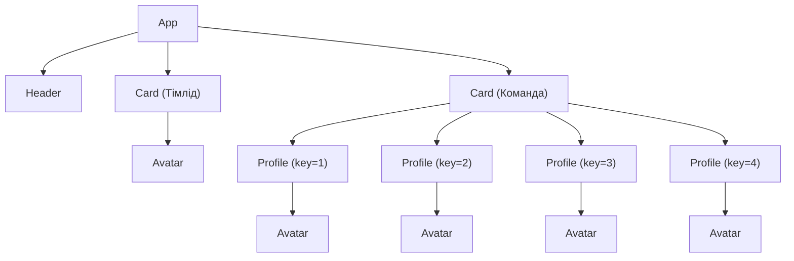
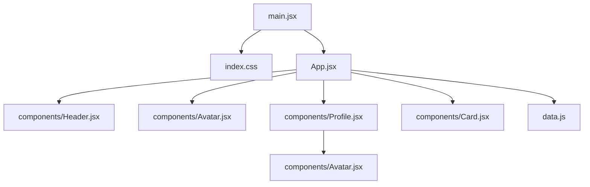

# ЛР-2. Компоненти, дерево компонентів і пропси

Стартовий проєкт лабораторної роботи № 2 курсу «Розробка вебзастосунків на
React»: сторінка «Команда проєкту». Інструкція:

У проєкті вже є налаштування ESLint і Prettier з ЛР-1, стилі сторінки
(`src/index.css`), дані команди (`src/data.js`) і аватари
(`public/avatars/`). Компоненти ви пишете самі, у теці `src/components/`.

## Команди

`npm install` виконуйте в корені репозиторію `react-labs`, решту — у теці
`lab-2/`:

- `npm run dev`: dev-сервер на http://localhost:5173
- `npm run lint`: ESLint
- `npm run format:check`: перевірка форматування Prettier
- `npm run build`: production-збірка в `dist/`

## Дерево рендерингу

Заповніть за вкладкою **Components ⚛** у React DevTools (§4.6).

## Дерево залежностей модулів

Заповніть за рядками `import` у файлах `src/` (§4.6).

